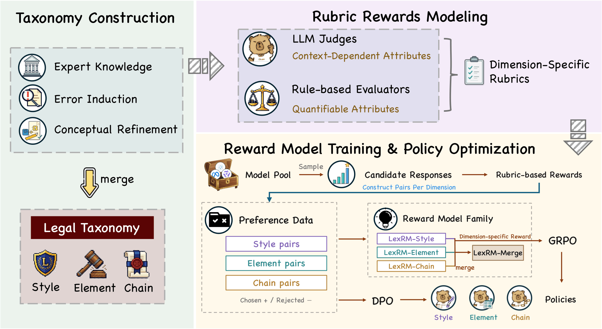
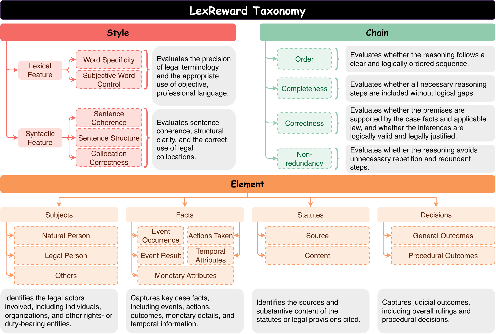

<h1 align="center">LexReward: A Taxonomy-Driven Reward Framework<br>for Legal Language Models</h1>

# News

- Our preprint [LexReward: A Taxonomy-Driven Reward Framework for Legal Language Models](https://arxiv.org/abs/2609.39071) has released.

# Introduction

High-quality legal responses require more than a correct final answer. They should use precise and objective language, identify relevant legal subjects and facts, apply appropriate statutes, and present complete and coherent reasoning. Coarse-grained holistic rewards can obscure these distinct requirements.

**LexReward** is a taxonomy-driven reward framework that decomposes legal response quality into three complementary dimensions:

| Dimension | Evaluation criteria |
| :--- | :--- |
| **Style** | Word specificity, subjective-word control, sentence coherence, sentence structure, and collocation correctness. |
| **Element** | Legal subjects, case facts, statutory grounds, and judicial decisions. |
| **Chain** | Reasoning order, completeness, correctness, and non-redundancy. |

The framework operationalizes these criteria with interpretable rule-based evaluators and LLM judges. Rubric scores guide preference construction from diverse model-generated responses. We then train **LexRM**, a family of dimension-specific reward models, with a Bradley-Terry pairwise objective.

The paper evaluates rubric rewards and LexRM through preference selection and test-time scaling, and studies downstream policy optimization with DPO and GRPO. Its experiments show that rubric-guided preference data and learned reward models improve legal response quality across the three dimensions.



# Project Structure

The code package is organized into three folders:

| Folder | Description |
| :--- | :--- |
| [`rubric_scorer/`](rubric_scorer/README.md) | Style v7.2 scoring, reference-free Element LLM judge (DeepSeek-V4-Flash), heuristic Chain scoring, and an LLM-based Chain judge, with reference statistics and lexical resources. |
| [`data_construction/`](data_construction/README.md) | CLASE, Element, and LexChain scripts for constructing RM preference data from scored five-model pools at a **5:3:2** tier ratio. |
| [`rm_training/`](rm_training/README.md) | Pairwise RM training, a ZeRO-3-aware training implementation, a launch script, and a DeepSpeed configuration. |

Dependency versions in `requirements.txt` and `requirements-training.txt` follow the environment: Python **3.11.15**, PyTorch **2.10.0** with CUDA **12.8**, and Transformers **4.57.6**.

<!-- This package provides Style and Chain implementations. The paper also studies Element rewards, model merging, DPO, GRPO, and downstream evaluation; those additional pipelines are outside this code package. Candidate pools, preference datasets, and model checkpoints are not bundled. -->

## Quick Start

Run commands from the repository root. Replace `/path/to/...` with your local inputs.

```bash
# Install scoring dependencies and inspect the construction entry points.
pip install -r requirements.txt
python data_construction/build_clase_rm_pairs.py --help
python data_construction/build_lexchain_rm_pairs.py --help

# Score a Chinese legal document with Style v7.2.
python rubric_scorer/style_scorer.py \
    --file /path/to/legal_text.txt --json

# Construct CLASE preference pairs from an already scored candidate pool.
python data_construction/build_clase_rm_pairs.py \
    --input /path/to/clase_scored_pool.jsonl \
    --output outputs/clase_rm_pairs_532.jsonl

# Construct LexChain preference pairs from an already scored candidate pool.
python data_construction/build_lexchain_rm_pairs.py \
    --input /path/to/lexchain_scored_pool.jsonl \
    --output outputs/lexchain_rm_pairs_532.jsonl \
    --num-pairs 4000 --seed 42
```

For RM training, install `requirements-training.txt` and the matching FlashAttention version, prepare separate training and validation files, and follow the examples in [RM Training](rm_training/README.md). For Chain rules, LLM-judge configuration, and detailed input formats, see the [Rubric Scoring](rubric_scorer/README.md) and [RM Data Construction](data_construction/README.md) guides.

# Dataset Statistics

The following statistics describe the **paper's experiments**, not dataset files distributed in this code package.

| Dimension | Source data | Training or construction data | Evaluation data |
| :--- | :--- | :--- | :--- |
| Style | CLASE | 4,000 training queries used for preference construction | 1,000 official test instances |
| Element | JEC-QA and LexChain | 2,736 source instances yielding 2,244 preference pairs | 3,000 LegalDelta in-domain test instances |
| Chain | LexChain | 9,550 training instances, including 4,000 queries allocated to preference training | 1,000 official test instances |

The paper uses a five-model candidate pool: **Qwen3-4B**, **Qwen3.5-4B**, **Qwen3.5-9B**, **Llama-3.1-8B-Instruct**, and **gemma-4-12B-it**. It uses **Qwen3-8B** as the backbone for trained models and **DeepSeek-V4-Flash** for LLM-based rubric evaluation.

The construction scripts rank five scored responses per query as r1 through r5 and assign selected queries to disjoint tiers:



| Tier | Ratio | Selection rule | Preferred / dispreferred response |
| :--- | ---: | :--- | :--- |
| A | 50% | Smallest r1-r2 gaps | r1 / r2 |
| B | 30% | Smallest r2-r4 gaps among queries outside A | r2 / r4 |
| C | 20% | Remaining queries | r1 / r5 |

For 4,000 selected queries, the scripts produce **2,000 A**, **1,200 B**, and **800 C** pairs. CLASE uses the entire supplied pool; LexChain first selects a reproducible subset using a random seed. Tie handling and exact schema requirements are documented in [RM Data Construction](data_construction/README.md).

# Dataset Format

Both constructors output chat-format RM preference pairs:

```json
{
  "chosen": [
    {"role": "user", "content": "Case facts and task instructions..."},
    {"role": "assistant", "content": "Preferred model-generated response..."}
  ],
  "rejected": [
    {"role": "user", "content": "Case facts and task instructions..."},
    {"role": "assistant", "content": "Dispreferred model-generated response..."}
  ],
  "meta": {
    "source_row_id": 0,
    "pair_group": "A",
    "tier_ratio": "5:3:2",
    "chosen_index": 0,
    "rejected_index": 1,
    "chosen_score": -0.2,
    "rejected_score": -0.8
  }
}
```

## Field Descriptions

| Field | Description |
| :--- | :--- |
| `chosen` | Chat messages containing the prompt and preferred generated response. |
| `rejected` | Chat messages containing the same prompt and dispreferred generated response. |
| `meta.source_row_id` | Identifier of the source query in the candidate pool. |
| `meta.pair_group` / `meta.tier` | Pair category A, B, or C. CLASE uses `pair_group`; LexChain uses `tier`. |
| `meta.tier_ratio` | Construction ratio, `5:3:2`. |
| `meta.chosen_index` / `meta.rejected_index` | Selected candidate indices in the original five-response pool. |
| Scores | CLASE records selected scores in `meta`; LexChain also provides top-level `chosen_score` and `rejected_score`. Higher scores are preferred. |

LexChain outputs additionally preserve `chosen_model`, `rejected_model`, all five scores in `meta.row_scores`, and `meta.judge_model`. Both training scripts consume the shared `chosen` and `rejected` fields.

# Dataset Example

The following pair is synthetic and shown in English for readability. The experiments use Chinese legal text.

```json
{
  "chosen": [
    {
      "role": "user",
      "content": "Rewrite the following case summary as a formal judicial explanation without adding facts: the loan is due and remains unpaid."
    },
    {
      "role": "assistant",
      "content": "The loan has matured, and the borrower has not fulfilled the repayment obligation. The outstanding loan therefore remains payable."
    }
  ],
  "rejected": [
    {
      "role": "user",
      "content": "Rewrite the following case summary as a formal judicial explanation without adding facts: the loan is due and remains unpaid."
    },
    {
      "role": "assistant",
      "content": "The money is due and they have not paid it back, so they still need to pay."
    }
  ],
  "meta": {
    "source_row_id": 0,
    "pair_group": "A",
    "tier_ratio": "5:3:2",
    "chosen_index": 0,
    "rejected_index": 1,
    "chosen_score": -0.2,
    "rejected_score": -0.8
  }
}
```

The example scores illustrate the format and are not reported experimental measurements. Construction inputs contain the five candidate responses and their scores; see the [input schemas](data_construction/README.md#inputs-and-outputs) for CLASE and LexChain.

## Citation

If you use this work, please cite our [arXiv preprint](https://arxiv.org/abs/2609.39071):

```bibtex
@article{cai2026lexrewardtaxonomydrivenrewardframework,
  title = {{LexReward}: A Taxonomy-Driven Reward Framework for Legal Language Models},
  author = {Yida Cai and Xin Dai and Bingxiang He and Huiyuan Xie and Yuxiao Ye and Zhenghao Liu and Yang Bai and Zhiyuan Liu},
  year = {2026},
  journal = {arXiv preprint arXiv:2609.39071}
}
```